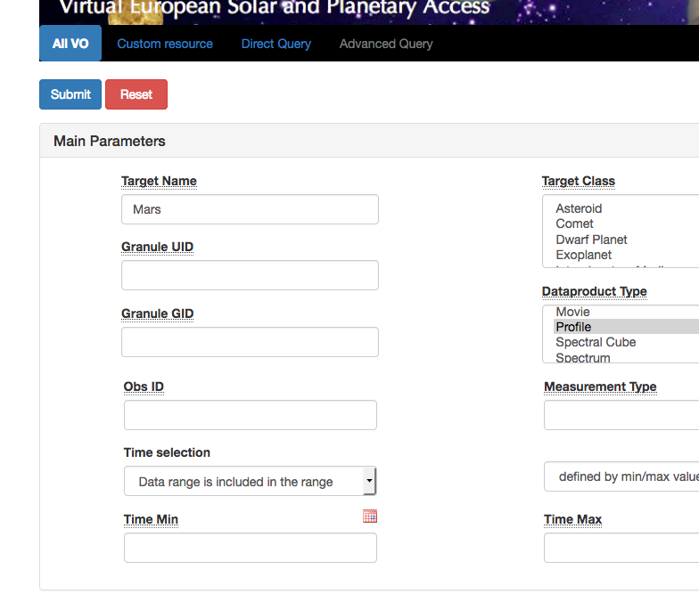
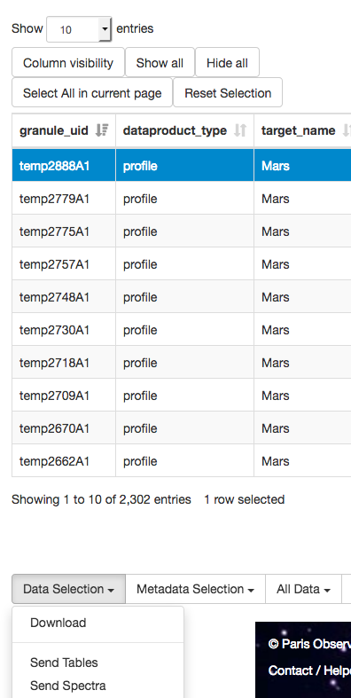
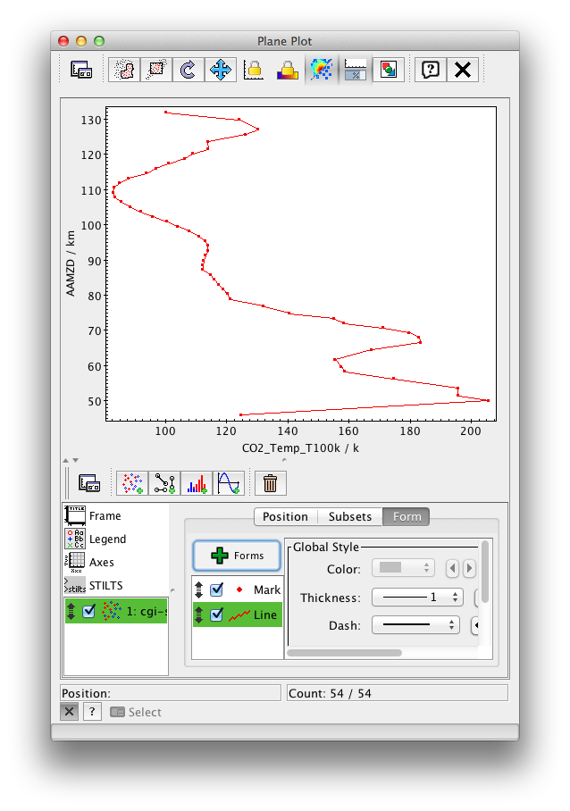
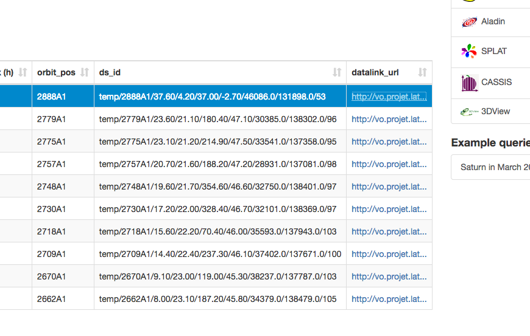
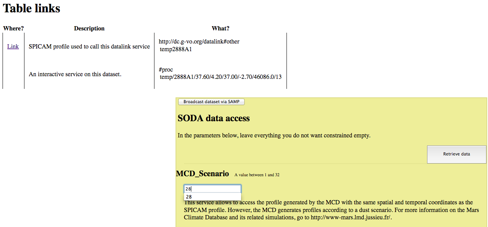
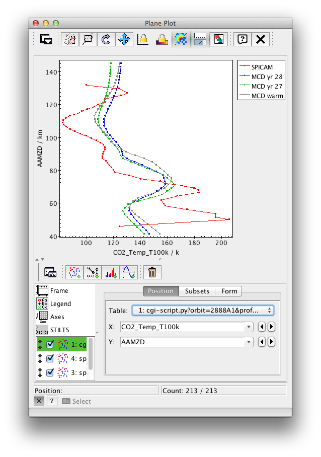

## Comparing vertical profiles in the atmosphere of Mars

[Use case](#use-case)
[Summary](#summary)
[Introduction](#introduction)
[To go further](#To-go-further) 

## Change log

| Version       | Author        | Notes  |
| ------------- |:-------------:| -----: |
| 1.1             | S. Erard      |  4/10/2018      |
| 1.2             | S. Erard      |  10/10/2026 - formal  |

## Use case
Comparing vertical profiles in the atmosphere of Mars (Mars-Express/SPICAM and Mars Climate Database simulations)

### Keywords
Atmospheres 
Observations
Simulations
Datalink

## Summary
This short tutorial shows how to compare related atmospheric profiles from various services.

## Introduction
The SPICAM service contains vertical profiles in the Martian atmosphere retrieved from inversion of spectral observations from Mars-Express. The Mars Climate Database (MCD) provides simulations of similar profiles in the frame of various scenarios related, e. g., to dust content in the atmosphere. To make comparisons easier, the SPICAM service also provides pre-parametered links to simulations from the MCD.

The workflow is described in successive steps.

### 1- Go to the VESPA portal

Go to the [VESPA portal](http://vespa.obspm.fr) and ask for the data of interest (Fig.1).

* Search for target = Mars, dataproduct_type = profile

*Fig. 1: Building the query in the portal*

### 2- Open service SPICAM in results page
* Click button "Show All" to see all parameters
* Browse service content
* Launch TOPCAT (e.g. by clicking on TOPCAT button in VESPA portal page)
* Select line  granule_uid = orbit2888A1_temp_SPICAMmeasurements (you can run another query adding this filter from the Data Reference menu)
* On bottom left menu "Data selection", click "Send Tables" and validate security dialogues in pop-up windows (Fig.2).

This sends the profile in VOTable format to TOPCAT

*Fig. 2: Sending selected results to TOPCAT via SAMP*

### 3- In TOPCAT
* Click icon "Plane Plot"
* (in the Position tab) Select X = CO2_Temp_T100k, and Y = AAMZD 
* Click Form tab, then the +Form button, select "Add Line" in local menu (Fig.3).

*Fig. 3: Plotting the  selected profile in TOPCAT*

### 4- Back to VESPA portal
* Go to the right end of the table
* Click value in Datalink_url of the selected line. A new page opens (Fig.4).

 *Fig. 4: Activating the DataLink in the portal*
 

### 5- DataLink interface
* This page first provides a link which opens the profile in ascii format
* In the yellow dialogue MCD_scenario, enter "28" (ID of the Martian year used in the simulation) and click "Retrieve data" (Fig.5).
* This opens a VOTable (xml-formatted) in your browser (this is a simulated profile in the same conditions as the observation)
* Copy the url from your browser and paste it to TOPCAT (click on "Open new Table" icon and paste it in the first field)

 *Fig. 5: Selecting an MCD scenario in DataLink*

### 6- Back to TOPCAT PlanePlot window
* Click icon "Add new positional plot"
* Select the last table in the local menu
* Select X = temperature and Y = AAMZD

This will add the modelled profile to the plot (Fig.6).

 *Fig. 6: Overplotting the model with the observation in TOPCAT*

You can similarly load other Martian year scenarios and check if they fit better (Fig.7)

 *Fig. 7: Overplotting other scenarios in TOPCAT*

## To go further
* In TOPCAT you can try other temperature profiles from the same SPICAM file (retrieved assuming other T at the top of the atmosphere)
* Other services propose measured profiles (NOMAD) or simulations (GEM_Mars) which can be intercompared - but no DataLink is currently installed.
* Other EPN-TAP data services include a datalink_url parameter that either links files or calls computing services. You may experiment with them (e.g., hst_planeto)

