## Retrieving DataLinks from a selection of granules using TOPCAT

[Use Case](#use-case) 
[Introduction](#introduction)  
[Load a subset of your EPN-TAP service in TOPCAT](#load-a-subset-of-your-epn-tap-service-in-topcat) 
[Using TOPCAT TAP access](#using-topcat-tap-access) 
[Using the VESPA portal](#using-the-vespa-portal) 
[Using the datalink service](#using-the-datalink-service) 
[Use the datalink service on one row](#use-the-datalink-service-on-one-row) 
[Use the datalink service in bulk](#use-the-datalink-service-in-bulk) 
[To go further](#to-go-further) 

## Change log

| Version       | Author        | Notes  |
| ------------- |:-------------:| -----: |
| 1.0             | C. Azria      |  20/9/2023      |
| 1.1             | S. Erard      |  10/10/2026 - formal  |

### Requirements 

Download the latest versions of VO tools: 

* TOPCAT: [TOPCAT](https://www.star.bristol.ac.uk/mbt/topcat/)

(older versions do not support DataLinks)

### Keywords

DataLink
TOPCAT

## Use case

In this example, we want to gather VOTables from the datalinks of a
subsection of the EPN-TAP service 'SPICAM' using TOPCAT.

## Introduction

DataLink is a VO standard used both to attach associated data or documents, and to call a service on the server side (e.g., ephemeris, cutout).
Datalink actually points to an associated table providing various entries, one set of links for each row of the main table. Here we focus on retrieving data files provided this way.

The first example in this tutorial shows how to access additional data files provided through datalink. We focus on the SPICAM EPN-TAP service of Martian atmospheric profiles. The main product for each row (under access\_url) is a measurement, it is associated with a series of profiles modelled according to various scenarios in the Mars Climate Database (under datalink_url). These links have selected during ingestion of the service to facilitate cross-matching. See [this other tutorial](https://github.com/epn-vespa/tutorials/blob/master/atmospheres/SPICAM_vs_MCD/profiles_Mars.md) for details.

TOPCAT makes it easy to gather such files from a collection of selected rows. It is important to notice that we can only gather datalinks with the same ID at a time.

A second example deals with the HST_planeto service. As in several services sharing telescopic observations, each row provides calls to the Miriade ephemeris service using the current target name and time. These return either a table, a web page, or a configuration image of the target.

## Load a subset of your EPN-TAP service in TOPCAT

### Using TOPCAT TAP access

- Open [TOPCAT](https://www.star.bristol.ac.uk/mbt/topcat/) software

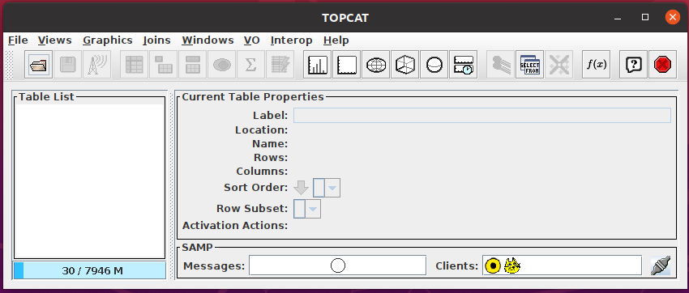

*Fig. 1: The TOPCAT main window*

- Use the Table Access protocol and search for the SPICAM service:

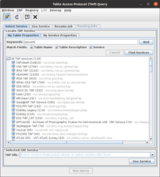

*Fig. 2: Searching for the SPICAM service in the TAP browser*

- Then make an ADQL query on this service, here we want to obtain a subset of 10 granules of this service

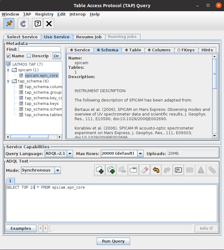

*Fig. 3: ADQL query to extract a subset of 10 granules*

- Click `run query`, it will load the subset of the epn_core service on the main TOPCAT window

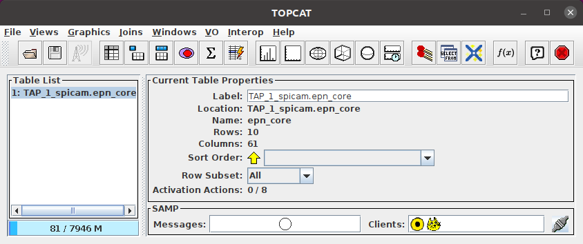

*Fig. 4: The subset of the epn_core table loaded in TOPCAT*

### Using the VESPA portal

You can also obtain the subset of your service using the VESPA portal.

- Open TOPCAT

- Open the [VESPA
  portal](https://voparis-vespa-client.obspm.fr/planetary/data/)

- Click on your service (here, SPICAM)

- Use the portal query criteria or ADQL to obtain your subset

- On the bottom of query page, click on All metadata > send tables

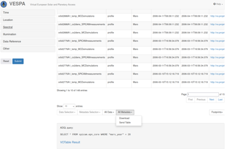

*Fig. 5: Sending the whole result table from the portal*

- Or, if you have selected the wanted granules manually, Metadata
  Selection > send tables

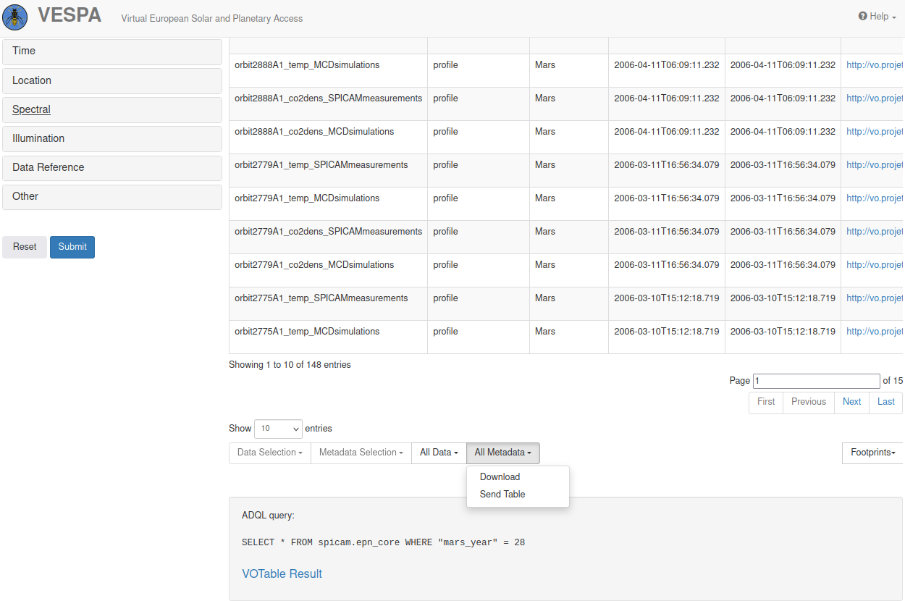

*Fig. 6: Sending a manual selection of granules from the portal*

- The subset of the epn_core table will be loaded in TOPCAT

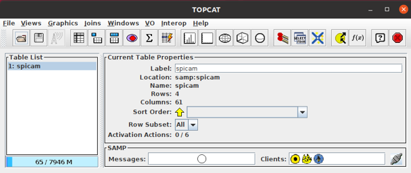

*Fig. 7: The subset table received in TOPCAT via SAMP*

## Using the datalink service

Now, to interrogate the datalink service :

- Open the table of the epn_core subset previously loaded on one side.

- On the other side, open the action window by clicking the action
   button.

- Check `View Datalink Table`

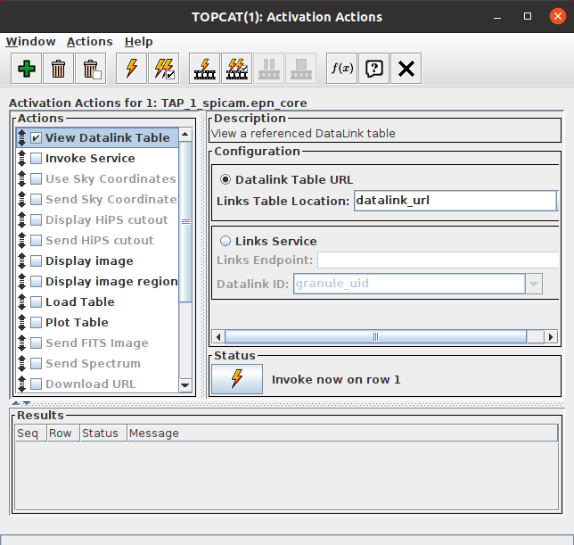

*Fig. 8: Activating the Datalink table in the Actions window*

- Click on one row of the epn_core table, the datalink table will be
  displayed

- In this service, the DataLink response lists links to VOTables. 
  You can click on a type of datalink in the list. For
  this example, we will use the ``coldmin`` type of link. Then, select
  the action you want to do with this link. In this case, we want to
  load the VOTable.

### Use the datalink service on one row

To load the datalink's ``coldmin`` VOTable for the selected granule of
the epn_core table, click `invoke`.

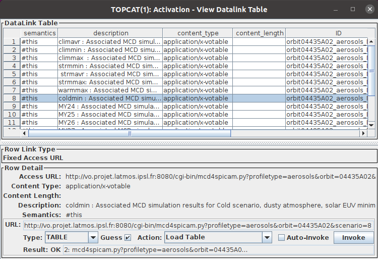

*Fig. 9: Invoking the coldmin datalink on the selected granule*

- It will load the associated VOTable in TOPCAT

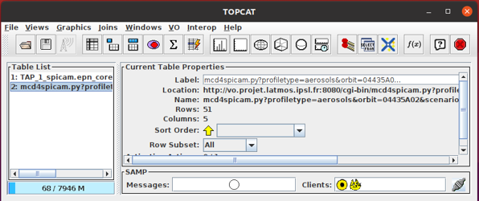

*Fig. 10: The VOTable retrieved via the datalink*

### Use the datalink service in bulk

To load all VOTables corresponding to ``coldmin`` datalink for the whole
selection of the epn_core service :

- Check the `Auto-Invoke` checkbox on the datalink table

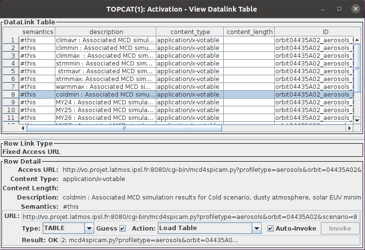

*Fig. 11: Checking the Auto-Invoke option*

- Return to the action window and click the `invoke selected action on all rows` button 

All corresponding VOTables will be loaded in TOPCAT

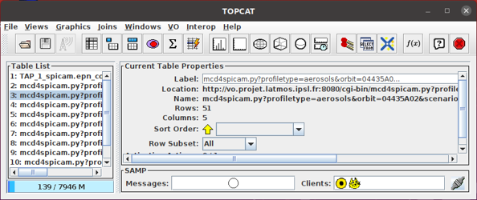

*Fig. 12: All the VOTables retrieved in bulk*

## To go further

You can select other types of actions to do with the datalinks from the datalink window (e.g. plot the retrieved tables, send them via SAMP).

The ``Auto-Invoke`` button is not available for datalinks using a form, since this is used to enter individual options.
