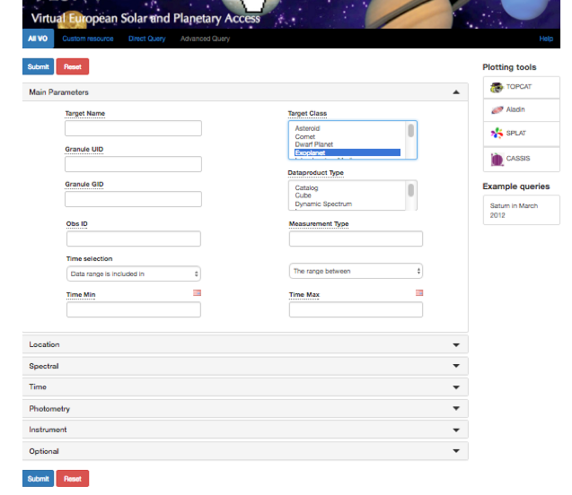

## <Title>

< One-paragraph summary: what the reader will learn and do.>

<!-- Anchors: lowercase, spaces → hyphens, drop < > and punctuation.
     "## 1- Search spectra" → "1--search-spectra -->

[Summary](#summary)  
[Introduction](#introduction)  
[1- <First section>](#1--first-section)  
[2- <Second section>](#2--second-section)  
[To go further](#to-go-further)

### Change log

| Version | Author | Notes |
| ------- | ------ | ----- |
| 1.0     | <name> | <date> |

### Requirements and dependencies

<Tools to download, with links. Indicate minimal versions if a feature requires a recent release.>

* Tool: [link](https://...)
* Support mail: [support.vespa@obspm.fr](mailto:support.vespa@obspm.fr)

### Keywords

<short>; <list>; <of>; <keywords>

## Summary

< Possibly include a short summary with use case and mention of tools or methods involved.>

## Introduction

<Context and motivation: what data, services, or scientific question this tutorial addresses.>

## 1- <First section>

<Prose explaining the step. Exact menu paths, button names, and queries.>

">

*Fig. 1: <Caption: what the reader should see on screen.>*

> Alternative: <side note or variant of the procedure, if any.>

## 2- <Second section>

<...>

## To go further

* Related tutorial: [link to another tutorial in the repository](../<area>/<tutorial>/<tutorial>.md)
* More information on VESPA: [http://www.europlanet-vespa.eu/](http://www.europlanet-vespa.eu/)
* VESPA data portal: [https://vespa.obspm.fr](https://vespa.obspm.fr)
* Support: [support.vespa@obspm.fr](mailto:support.vespa@obspm.fr)